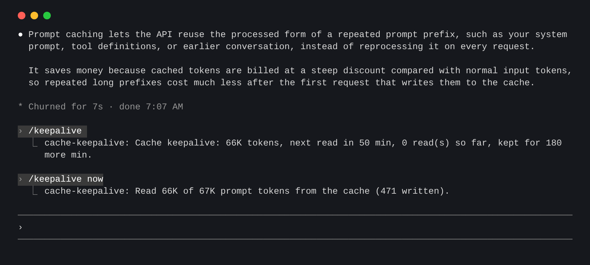
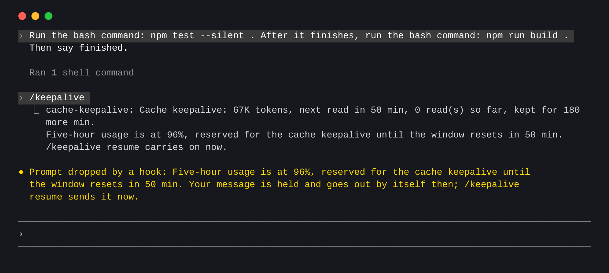

# cache-keepalive

[中文说明](README_CN.md)

A Claude Code plugin that keeps an idle session's prompt cache alive.

Step away from a long conversation and its cache expires after an hour. Your next message then pays to write the whole conversation again, about 20 times what reading it costs. While the session stays open, this plugin sends one small throwaway request every 50 minutes that reads the cache and restarts its hour. When your five-hour usage runs low, it also pauses new work so there is room left for those reads.



<sub>A real session. `minTokens` was lowered so that this short conversation qualifies.</sub>

## Install

At the prompt of a terminal session:

```
/plugin install cache-keepalive --marketplace devilcoolyue/claude-cache-keepalive
```

Answer `y` to add the marketplace, then pick a scope. From a shell:

```
claude plugin install cache-keepalive --marketplace devilcoolyue/claude-cache-keepalive
```

In the desktop app: click + next to the prompt box, then Plugins, Add marketplace with `devilcoolyue/claude-cache-keepalive`, then Add plugin.

Tested on Claude Code 2.1.319.

## Status

It works on its own once installed. The hint line under the prompt shows what it is doing, and it needs no setup, so it sits happily below a status line such as claude-hud:

| Shown | Meaning |
| --- | --- |
| `keepalive next read in 42m (2 reads)` | Keeping the cache warm |
| `keepalive on` | A turn is running; the next read is planned when it ends |
| `keepalive paused at 96%, resets in 50m, 1 held` | A five-hour pause, and the messages waiting for the reset |
| `keepalive starts after the next turn` | Nothing yet: a plan is made when a turn ends |
| `keepalive skipped: 60K is below 100K` | Not kept. The other skip is `5-minute cache` |
| `keepalive stopped` | It ended; `/keepalive` says why |

The countdown refreshes once a minute. It shows in the terminal only, and `showStatus: false` hides it.

## Commands

There is one command, `/keepalive`:

| Command | What it does |
| --- | --- |
| `/keepalive` or `/keepalive status` | Shows the next read, the reads so far, how much longer the cache is kept, or why nothing is planned |
| `/keepalive on` / `off` | Starts or stops it for this session. `off` also ends a pause |
| `/keepalive now` | Reads the cache once and reports how much it found. This is a real request, and it ignores the size and account checks |
| `/keepalive resume` | Ends a five-hour pause and carries on in this window |

## When it runs

After each turn it plans a read if both of these hold:

- The account writes one-hour caches. Subscriptions do. API keys and relays write five-minute caches by default, which a keepalive cannot pay for, so they are skipped.
- The conversation has at least 100K tokens. A smaller one is cheap to cache again.

A new turn replaces the plan, and no read is sent while a turn is running. It stops, without sending anything further, when:

- 3 hours have passed since your last turn (longer during a pause, see below)
- the five-hour limit, the weekly limit or a spend limit is used up: a read would be refused, or billed as extra usage
- a read finds the cache gone, or a request fails
- the conversation was compacted or cleared, or you switched model
- the cache's hour already ran out, for example because the computer slept

## Five-hour pause

A long turn can use up the five-hour window, and then keepalive reads are refused too, so the cache goes cold before the window starts over. To reserve room for them, once a response reports the window at 95%:

- The running turn stops before its next model request. Tools that are running finish first.
- Messages you send wait, and go out by themselves after the reset. A message with attachments is refused instead, so send it again later.
- After the reset the stopped turn carries on by itself, unless you left messages for it. Reads continue until 15 minutes past the reset, at most 6 hours after your last turn.



<sub>A real session with a simulated 96% reading.</sub>

`/keepalive resume` ends a pause early, and `pausePercent: 0` turns pausing off.

The window is read from the responses this session receives, so usage elsewhere shows up with this session's next response. Conversations under `minTokens` are never paused, background agents keep running, and held messages are lost if you close the session.

## Settings

| Setting | Default | Meaning |
| --- | --- | --- |
| `minTokens` | `100000` | The smallest conversation worth keeping or pausing for |
| `intervalMinutes` | `50` | Minutes between reads (30–55) |
| `pausePercent` | `95` | Five-hour usage that pauses the session (50–99, or 0 never to pause) |
| `maxHours` | `3` | How long after the last turn to keep the cache (1–24) |
| `enabled` | `true` | Keep caches at all |
| `showStatus` | `true` | Show the state in the hint line under the prompt |
| `hourCacheOnApiKey` | `false` | Turn on only if your API key or relay is set up to write one-hour caches |

Change them inside Claude Code:

```
/plugin configure cache-keepalive@claude-cache-keepalive
```

Or from a shell, where every value is a string and options you leave out keep their values:

```
echo '{"minTokens":"50000","intervalMinutes":"40","pausePercent":"90"}' | claude plugin configure cache-keepalive@claude-cache-keepalive --values-stdin
```

Restart Claude Code to apply a change. A value outside its range is moved to the nearest allowed value.

## What it costs

Each read is a real request billed to your account: the whole conversation at the cache-read rate, about a tenth of the input price, plus a few tokens of output. On a subscription it counts toward your usage limits. With the defaults that is at most three reads per idle stretch. It pays off when you come back to the conversation, and is wasted when you do not.

## Limits

- **It only runs while the session is open.** The plugin lives inside the Claude Code process, so closing the terminal ends it.
- A read is a fork of the session: it uses the same model, system prompt and history, saves nothing to the transcript, and cannot use tools.
- The very first read after a session's first turn may find only part of the cache. The next real turn behaves the same way; from the second turn on, reads match in full.

## Development

```
claude plugin validate .
claude plugin test .
claude --plugin-dir .
```

## License

[Apache-2.0](LICENSE)
