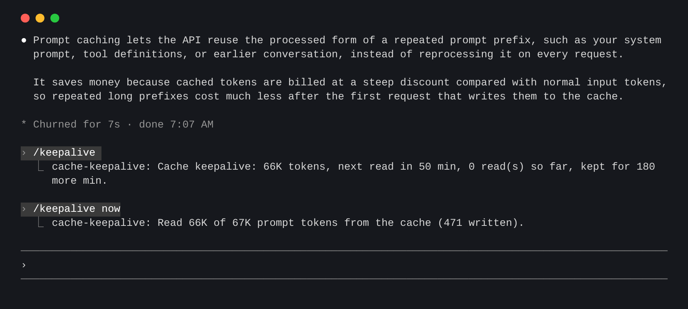
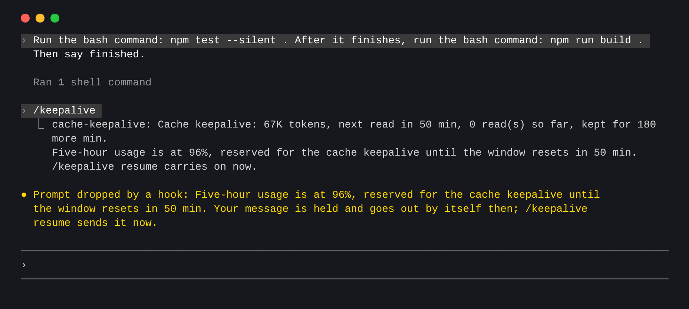

# cache-keepalive

[English](README.md)

一个 Claude Code 插件，让空闲会话的提示词缓存不过期。

长对话放着不动，缓存一小时后就会过期。你回来发下一条消息时，要把整段对话重新写入缓存，成本大约是读取的 20 倍。只要会话还开着，这个插件每 50 分钟发一个很小的一次性请求读取缓存，让缓存的一小时重新计时。5 小时额度快用完时，它还会暂停新的工作，给这些读取留出额度。



<sub>真实会话截图。为了让这段短对话符合条件，调低了 `minTokens`。</sub>

## 安装

在终端会话的输入框里：

```
/plugin install cache-keepalive --marketplace devilcoolyue/claude-cache-keepalive
```

按 `y` 添加 marketplace，再选择安装范围。或者在 shell 里：

```
claude plugin install cache-keepalive --marketplace devilcoolyue/claude-cache-keepalive
```

桌面应用：点输入框旁的 +，选 Plugins，用 `devilcoolyue/claude-cache-keepalive` 添加 marketplace，再添加插件。

已在 Claude Code 2.1.319 上测试。

## 命令

安装后自动工作。只有一个命令 `/keepalive`：

| 命令 | 作用 |
| --- | --- |
| `/keepalive` 或 `/keepalive status` | 显示下次读取时间、已读取次数、还会保活多久，或没有计划的原因 |
| `/keepalive on` / `off` | 在当前会话开启或关闭。`off` 同时结束暂停 |
| `/keepalive now` | 立刻读取一次并报告命中多少。这是一次真实请求，不看对话大小和账号类型 |
| `/keepalive resume` | 提前结束 5 小时暂停，在当前窗口继续工作 |

## 什么时候生效

每轮结束后，同时满足以下条件才会安排读取：

- 账号写的是 1 小时缓存。订阅账号是；API Key 和中转默认写 5 分钟缓存，保活不划算，会跳过。
- 对话至少 10 万 token。更小的对话重新缓存也不贵。

新的一轮会替换原计划，回合运行期间不会发送读取请求。出现以下情况会停止，不再发送请求：

- 距离上一轮已满 3 小时（暂停期间会延长，见下文）
- 5 小时额度、每周额度或消费上限已用尽：此时读取会被拒绝，或被计入超额付费
- 读取时发现缓存已失效，或请求失败
- 对话被压缩或清空，或切换了模型
- 缓存的一小时已经过去（例如电脑休眠）

## 5 小时额度暂停

一个长回合可能把 5 小时额度用光，之后保活请求也会被拒绝，缓存在额度重置前就失效了。为了给保活留出额度，当响应报告额度达到 95% 时：

- 正在运行的回合会在下一次模型请求前停住，已在执行的工具会先跑完。
- 暂停期间发送的消息会暂存，重置后自动发出。带附件的消息会被拒绝，需要之后重新发送。
- 重置后，被停住的回合自动继续；如果你留了消息，则改为发送你的消息。保活持续到重置后 15 分钟，最长不超过上一轮结束后 6 小时。



<sub>真实会话截图，其中 96% 的额度读数是模拟的。</sub>

`/keepalive resume` 可以提前结束暂停，`pausePercent: 0` 可以关闭暂停功能。

额度数据来自本会话收到的响应，其他地方的用量要等本会话下一次响应才能反映出来。小于 `minTokens` 的对话不会暂停，后台 agent 不受影响，暂存的消息在关闭会话后会丢失。

## 配置

| 配置项 | 默认值 | 含义 |
| --- | --- | --- |
| `minTokens` | `100000` | 值得保活或暂停的最小对话大小 |
| `intervalMinutes` | `50` | 两次读取的间隔（30–55 分钟） |
| `pausePercent` | `95` | 触发暂停的 5 小时用量（50–99，0 表示不暂停） |
| `maxHours` | `3` | 上一轮结束后最多保活多久（1–24 小时） |
| `enabled` | `true` | 是否启用 |
| `hourCacheOnApiKey` | `false` | 只有 API Key 或中转确实配置成写 1 小时缓存时才打开 |

在 Claude Code 里修改：

```
/plugin configure cache-keepalive@claude-cache-keepalive
```

或者在 shell 里修改，所有值都写成字符串，没写的配置项保持原值：

```
echo '{"minTokens":"50000","intervalMinutes":"40","pausePercent":"90"}' | claude plugin configure cache-keepalive@claude-cache-keepalive --values-stdin
```

修改后要重启 Claude Code 才生效。超出范围的值会被调整到最接近的允许值。

## 成本

每次读取都是计入账号的真实请求：整段对话按缓存读取价计费（约为输入价的十分之一），再加几个输出 token。订阅账号会占用用量额度。默认配置下每段空闲最多读取 3 次。回来继续对话才划算，不回来就白花了。

## 限制

- **只在会话开着时运行。** 插件运行在 Claude Code 进程里，关掉终端就结束了。
- 读取是当前会话的一次 fork：模型、系统提示和历史都相同，不写入转录，也不能使用工具。
- 会话第一轮后的第一次读取可能只命中一部分缓存，下一轮真实请求也一样；从第二轮起都能完整命中。

## 开发

```
claude plugin validate .
claude plugin test .
claude --plugin-dir .
```

## 许可证

[Apache-2.0](LICENSE)
